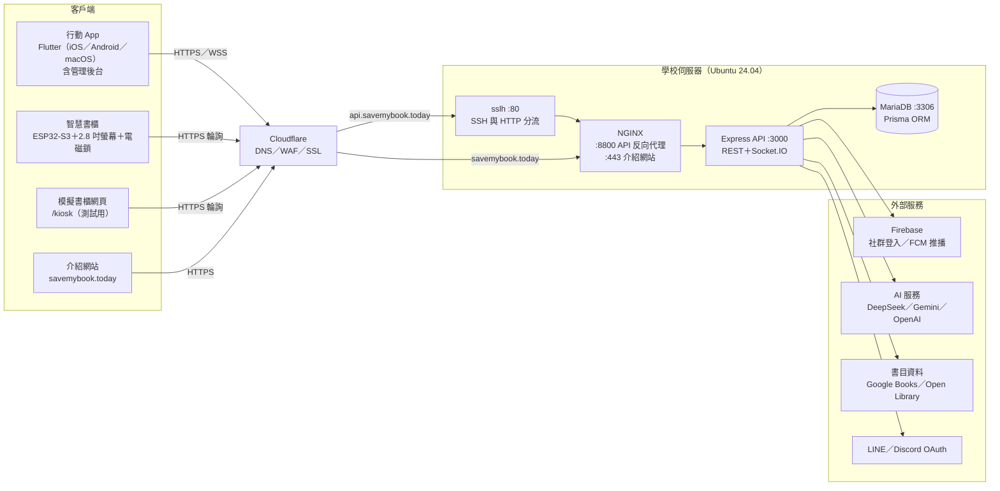
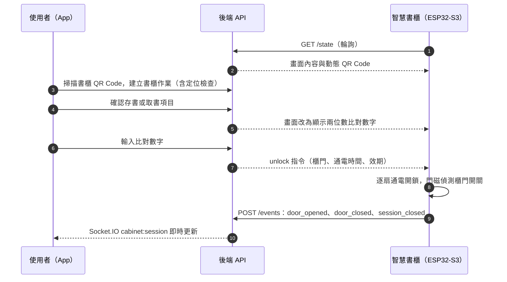

<h1 align="center">救「舊」我的書 SaveMyBook</h1>

<p align="center">結合行動 App 與智慧書櫃的校園二手書交易系統</p>

<p align="center">
  <a href="https://savemybook.today">介紹網站</a> ・
  <a href="https://api.savemybook.today/api-docs">API 文件</a> ・
  <a href="#部署">部署</a> ・
  <a href="#開發統計">開發統計</a>
</p>

---

## 目錄

- [系統概要](#系統概要)
- [系統架構](#系統架構)
- [智慧書櫃作業流程](#智慧書櫃作業流程)
- [儲存庫結構](#儲存庫結構)
- [後端 API](#後端-api)
- [行動 App](#行動-app)
- [智慧書櫃](#智慧書櫃)
- [裝置通訊協定](#裝置通訊協定)
- [介紹網站](#介紹網站)
- [部署](#部署)
- [安全設計](#安全設計)
- [測試](#測試)
- [自動化](#自動化)
- [文件與圖表](#文件與圖表)
- [團隊](#團隊)
- [開發統計](#開發統計)

## 系統概要

校園二手書面交常遇到時間難以配合、書況與描述不符、預付後遭詐騙等問題。本系統以「先驗收、後撥款」處理交易信任，並以智慧書櫃提供 24 小時非同步交付。

| 功能 | 說明 |
| --- | --- |
| ISBN 掃描上架 | 掃描條碼帶入書名、作者、出版社（Google Books、Open Library），AI 協助填寫書況描述並預先審核上架內容 |
| 智慧書櫃交付 | 賣家掃描書櫃螢幕上的 QR Code 存書，買家隨時取書；手機輸入書櫃螢幕上的比對數字後開門 |
| 先驗收、後撥款 | 買家取書並確認書況後才撥款給賣家；書況不符可提出申訴，暫停交易並由管理員處理 |
| 即時互動 | 買賣雙方即時聊天、語音訊息、訂單推播通知，以及 AI 客服 |
| 會員經營 | 會員等級、成就徽章與錢包 |
| 多元登入 | 帳號密碼、Google、Apple、LINE、Discord、手機簡訊、通行密鑰（Passkey）與生物辨識 |
| 管理後台 | 會員、書籍、訂單、申訴、檢舉、書櫃裝置、公告、客服、法律文件、AI 設定與用量、資料庫備份 |

## 系統架構

系統分為客戶端、雲端代理（Cloudflare）與學校伺服器三層，並串接 Firebase、AI 與書目資料等外部服務。



完整部署圖見 [`Diagrams/System Architecture/v3/deployment.png`](Diagrams/System%20Architecture/v3/deployment.png)。

| 元件 | 技術與版本 | 目錄 |
| --- | --- | --- |
| 行動 App | Flutter 3.47（Dart ^3.10.7），版本 1.0.3+24；iOS 15.5+、Android 7.0（API 24）+、macOS 10.15+ | [`savemybook_app`](savemybook_app) |
| 後端 API | Node.js、Express 5.2、Socket.IO 4.8、Prisma 7.6、SimpleWebAuthn 14 | [`savemybook_api`](savemybook_api) |
| 資料庫 | MariaDB／MySQL，約 80 個資料模型 | [`savemybook_api/prisma`](savemybook_api/prisma) |
| 書櫃韌體 | ESP32-S3（N16R8）、ESP-IDF 6.1、PlatformIO espressif32 7.1.3 | [`savemybook_firmware`](savemybook_firmware) |
| 書櫃主控板 | 自製「DoorLock ESP32-S3 主控板」Rev A（KiCad 10） | [`savemybook_firmware/pcb`](savemybook_firmware/pcb) |
| 介紹網站 | Vite 8、TypeScript 7、three.js 0.186 | [`savemybook_web`](savemybook_web) |
| 伺服器 | Ubuntu 24.04、NGINX、sslh、Cloudflare | — |
| 書櫃機構 | SolidWorks 2025 建模、壓克力雷射切割、3D 列印零件 | [`hardware_design`](hardware_design) |

## 智慧書櫃作業流程

書櫃不維持長連線，以 HTTPS 輪詢後端：閒置時每 2 秒、作業中每 1 秒。App 端的作業狀態由 Socket.IO 即時推送。



書櫃 QR Code 格式為 `savemybook://k/<32 位十六進位>`。作業狀態依序為 `selecting`、`matching`、`opening`、`open`，結束時為 `completed`、`partial`、`cancelled`、`failed`、`expired` 或 `needs_review`。

## 儲存庫結構

```text
SaveMyBook/
├── .github/workflows/        # GitHub Actions：每日更新本文件的開發統計
├── savemybook_api/           # 後端 API（Node.js／Express）
│   ├── config/               # 環境變數檢查與 OpenAPI 組裝
│   ├── constants/            # 業務常數與政策設定
│   ├── docs/                 # OpenAPI 文件（41 個 YAML）
│   ├── jobs/                 # 排程工作
│   ├── lib/                  # 共用函式（驗證、ISBN、推播、AI 等）
│   ├── middleware/           # 驗證、管理員權限、二次驗證、裝置驗證、限流、安全標頭
│   ├── prisma/               # 資料庫 Schema 與初始資料
│   ├── routes/               # API 路由（含 admin 後台）
│   ├── services/             # 業務邏輯（訂單、書櫃、聊天、推播、AI、交通資訊等）
│   ├── scripts/              # 部署驗證、冒煙測試、書櫃配對與模擬等工具
│   ├── test/                 # 自動化測試
│   ├── views/                # 模擬書櫃（/kiosk）、法律條款與公開頁面
│   ├── app.js                # Express 組裝
│   └── index.js              # 伺服器進入點
├── savemybook_app/           # 行動 App（Flutter）
│   ├── lib/
│   │   ├── features/         # 功能畫面（帳號、後台、登入、書籍、書櫃、聊天、首頁、訂單、安全、上架）
│   │   ├── models/           # 資料模型
│   │   ├── services/         # API 串接、即時連線、推播、通行密鑰等服務
│   │   ├── widgets/          # 共用元件
│   │   ├── i18n/             # 多語系字串（.arb）
│   │   ├── utils/            # 配色、主題、工具函式
│   │   └── main.dart         # App 進入點
│   ├── assets/               # 圖片、字型等靜態資源
│   ├── docs/                 # 通行密鑰、社群登入、推播、隱私權設定說明
│   ├── firebase/             # Firebase 設定檔與產生說明
│   ├── test/                 # 自動化測試
│   ├── tool/                 # 多語系、Firebase 設定與截圖腳本
│   └── android/ ios/ macos/  # 各平台專案
├── savemybook_firmware/      # 智慧書櫃韌體（ESP32-S3）
│   ├── src/                  # 韌體原始碼
│   ├── tools/                # 電腦端邏輯測試、畫面預覽、字型與標誌產生器
│   ├── pcb/                  # 主控板 Rev A 原理圖、BOM、Gerber、固定座
│   └── docs/                 # 畫面總覽圖
├── savemybook_web/           # 系統介紹網站（Vite＋three.js）
├── Diagrams/                 # 系統分析與設計圖表（架構、類別、循序、狀態機、電路等）
├── documents/                # 系統手冊、系統簡介、部署清單、個資法資料、使用手冊截圖
├── hardware_design/          # 書櫃 3D 建模與切片檔（v1–v7、v8_protect 鉸鏈保護蓋）
├── presentation/             # 評審簡報、海報、介紹動畫與影片
├── branding/                 # Logo、識別證、貼紙
├── ui_ux_design/             # 介面設計稿與線框圖
├── market_research/          # 競品分析與需求問卷
├── competition/              # 競賽簡章、報名表與上傳資料
├── meeting_minutes/          # 會議紀錄
└── database/                 # 早期資料庫腳本與測試資料（現行結構以 Prisma Schema 為準）
```

## 後端 API

位於 [`savemybook_api`](savemybook_api)。採 `routes/` → `services/` → Prisma 分層，路由前綴集中在 `routes/index.js`。啟動時依序檢查環境變數、組裝 Express、掛上 Socket.IO，再啟動排程，收到 `SIGTERM`／`SIGINT` 時依序關閉。

### 介面

| 項目 | 說明 |
| --- | --- |
| REST 前綴 | `/api/` 之下：`users`、`auth`、`auth/passkeys`、`security`、`books`、`categories`、`cabinets`、`cabinet-sessions`、`device/v1`、`favorites`、`cart`、`orders`、`wallet`、`disputes`、`reports`、`chat`、`notifications`、`announcements`、`support`、`push`、`uploads`、`backup-downloads`、`status`、`ai`、`admin` |
| 其他路徑 | `/kiosk`（模擬書櫃）、`/.well-known`（通行密鑰與 App 關聯檔）、公開頁面 |
| API 文件 | Scalar 介面 `/api-docs`、規格 `/openapi.json`，由 `docs/*.yaml` 組成 |
| 使用者驗證 | `Authorization: Bearer <JWT>`，`POST /api/auth/refresh` 換發；每次請求都向資料庫確認帳號與登入狀態 |
| 管理員 | 同一套 JWT，另依分區權限（會員、訂單、書櫃、系統等）檢查；敏感操作需 `X-Verify-Token` 二次驗證 |
| 即時通訊 | Socket.IO（`/socket.io`），以使用者 JWT 驗證並每 5 分鐘重新驗證；事件 `chat:room`、`chat:typing`、`cabinet:session` |
| 書櫃裝置 | `/api/device/v1`，見[裝置通訊協定](#裝置通訊協定) |

### 排程

`jobs/scheduler.js` 在 API 行程內執行，系統維護模式時暫停。

| 工作 | 頻率 |
| --- | --- |
| 書櫃作業巡檢 | 每 15 秒 |
| 裝置離線巡檢 | 每 1 分鐘 |
| 預約到期 | 每 5 分鐘 |
| 訂單與存書自動處理 | 每 10 分鐘 |
| 資料庫備份（mysqldump） | 每小時檢查，每 24 小時備份一次，保留 14 份 |
| 其他 | 語意索引、AI 預算、書目補齊、帳號刪除、交通資訊重建 |

### 環境變數

範本見 `savemybook_api/.env.example`。只有 `DATABASE_URL` 與 `JWT_SECRET` 必填，缺少時無法啟動；`JWT_SECRET` 建議 32 字元以上。

| 用途 | 變數 |
| --- | --- |
| 基本 | `PORT`（3000）、`NODE_ENV`、`PUBLIC_ID_SECRET`、`JWT_EXPIRES_IN`（24h）、`PUBLIC_WEB_URL`、`CORS_ORIGINS`、`TRUST_PROXY` |
| AI | `DEEPSEEK_API_KEY`、`GEMINI_API_KEY`、`OPENAI_API_KEY`（皆未設定時停用 AI 功能） |
| 書目 | `GOOGLE_BOOKS_API_KEY` |
| Firebase 與推播 | `FCM_SERVICE_ACCOUNT_FILE`（或 `GOOGLE_APPLICATION_CREDENTIALS`）、`PUSH_ENABLED`、`FIREBASE_PROJECT_ID` |
| LINE／Discord 登入 | `LINE_CHANNEL_ID`、`LINE_CHANNEL_SECRET`、`DISCORD_CLIENT_ID`、`DISCORD_CLIENT_SECRET`、`OAUTH_REDIRECT_BASE` |
| 通行密鑰與 App 關聯 | `PASSKEY_RP_ID`、`PASSKEY_RP_NAME`、`PASSKEY_ORIGINS`、`APPLE_TEAM_ID`、`IOS_BUNDLE_ID`、`ANDROID_PACKAGE_NAME`、`ANDROID_CERT_SHA256` |
| 智慧書櫃 | `CABINET_SIMULATOR`（啟用 `/kiosk`）、`CABINET_QR_SECRET`、`CABINET_TIMEZONE`（Asia/Taipei）、`TRANSIT_DATA_DIR` |
| 備份 | `BACKUP_ENABLED`、`BACKUP_DIR`、`BACKUP_KEEP` |

### 本機執行

需要 Node.js 20.19+ 或 22.12+（Prisma 7 的需求）與 MariaDB／MySQL。

```bash
cd savemybook_api
cp .env.example .env                          # 至少填入 DATABASE_URL 與 JWT_SECRET
npm install
npx prisma db push                            # 依 prisma/schema.prisma 建立資料表
npx prisma generate
mysql -u <帳號> -p <資料庫> < prisma/seed.sql   # 法律文件與常見問題初始資料，可重複執行
npm start                                     # http://localhost:3000/api-docs
```

| 指令 | 用途 |
| --- | --- |
| `npm test` | 執行全部測試（不需要資料庫與 `.env`） |
| `npm run docs:check` | 檢查路由與 OpenAPI 文件是否一致 |
| `npm run verify` | 部署檢查：環境變數、資料庫連線、Schema 一致性、Prisma Client、上傳目錄、mysqldump、Firebase 金鑰 |
| `npm run smoke` | 對執行中的 API 做冒煙測試（`--base --email --password`） |
| `node scripts/cabinet-device.js` | 書櫃裝置配對、列出、撤銷 |
| `node scripts/simulate-cabinet-flow.js` | 模擬完整的書櫃作業 |

## 行動 App

位於 [`savemybook_app`](savemybook_app)。買賣家功能與管理後台共用同一份程式碼，以 iOS、Android、macOS 為主要平台；iOS 另有通知擴充與桌面小工具。

| 項目 | 說明 |
| --- | --- |
| 狀態管理 | 不使用第三方框架，以 `ValueNotifier`／`ChangeNotifier` 為主，偏好設定存於 shared_preferences |
| 網路 | http、socket_io_client；API 位址為 `https://api.savemybook.today/api`（`lib/services/api_service.dart`），各領域 API 拆在 `lib/services/api/` |
| 帳號與安全 | Firebase Auth、Google、Apple 登入、passkeys、local_auth、flutter_secure_storage |
| 推播 | Firebase Cloud Messaging，含帶頭像的聊天通知 |
| 掃描與定位 | mobile_scanner（ISBN 與書櫃 QR Code）、geolocator（書櫃距離檢查與交通資訊） |
| 主題 | 8 組主色（預設霧藍 #627D8D），由 `lib/utils/app_palette.dart` 推導深淺色階；支援淺色、深色、跟隨系統 |
| 多語系 | 繁體中文（預設）、簡體中文、英文、日文、韓文；以 `python3 tool/gen_l10n.py` 從 `lib/i18n/*.arb` 產生 |
| 字型 | Noto Sans TC（100–900） |

```bash
cd savemybook_app
flutter pub get
python3 tool/firebase_setup.py    # 由 firebase/ 內的設定檔產生 lib/firebase_options.dart
flutter run --dart-define=GOOGLE_SERVER_CLIENT_ID=<Google 伺服器用戶端 ID>
flutter test
```

Android 正式版簽章讀取 `android/key.properties`（不納入版本控制）；缺少時改用除錯金鑰，通行密鑰將無法使用。相關設定說明：

- [社群登入設定](savemybook_app/docs/social-login-setup.md)
- [通行密鑰設定](savemybook_app/docs/passkey-setup.md)（RP ID 為 `savemybook.today`，需 iOS 16+、Android 9+）
- [聊天推播通知](savemybook_app/docs/rich-chat-notifications.md)
- [Apple 隱私權設定](savemybook_app/docs/apple-privacy.md)
- [Firebase 設定檔](savemybook_app/firebase/README.md)

## 智慧書櫃

### 硬體

櫃體寬 31 × 深 31 × 高 38 公分，主體為 9 mm 合板，正面面板與四扇櫃門為 5 mm 壓克力雷射切割。櫃門由上而下為 A01–A04，每格平放一本書；鉸鏈在右側，電磁鎖裝在左側、門外有木製把手，螢幕橫放在左上角。

| 元件 | 規格 |
| --- | --- |
| 主控 | ESP32-S3-DevKitC-1 相容開發板（N16R8：16 MB Flash、8 MB 八線 PSRAM），以排母插在主控板上 |
| 主控板 | 自製 DoorLock ESP32-S3 主控板 Rev A：12V DC 輸入（5.5×2.1），L7805 降 5V（需散熱片） |
| 繼電器驅動 | 4 路，低電位觸發：GPIO → PC815 光耦合器 → S8050 → JQC3F-05VDC-C，線圈與電磁鎖皆有續流二極體；JD-VCC 跳帽（JP1）須短接 |
| 電磁鎖 | 12V 0.6A × 4，通電開鎖、斷電上鎖，接繼電器 NO 接點 |
| 門磁 | MS-004V3 微動開關 × 4，門關上時壓下；接頭只能接 3V3 |
| 螢幕 | 2.8 吋 SPI TFT（ST7789，TN 面板），以橫向 320×240 使用，觸控與 SD 卡不接 |

主控板原理圖、BOM 與 Gerber 位於 [`savemybook_firmware/pcb`](savemybook_firmware/pcb)。

| 功能 | GPIO |
| --- | --- |
| 繼電器 A01–A04 | 4、5、6、7 |
| 螢幕 RST／DC／CS | 8、9、10 |
| 螢幕 MOSI／SCK（SPI2） | 11、12 |
| 螢幕背光（PWM） | 13 |
| 門磁 A01–A04 | 39、40、41、42 |
| BOOT 鍵（長按 5 秒重設 Wi-Fi） | 0 |

### 韌體架構

位於 [`savemybook_firmware`](savemybook_firmware)，以 PlatformIO 建置，框架為 ESP-IDF（不使用 Arduino，以便使用內建憑證套件、Flash 加密與 NVS 加密）。裝置邏輯移植自模擬書櫃的 `device-core.js`，兩邊行為一致。

| 工作 | 核心 | 優先權 | 職責 |
| --- | --- | --- | --- |
| `locks` | 不固定 | 6 | 依序開鎖：逐扇通電 3 秒，鎖與鎖之間間隔 300 ms，同一時間只有一個電磁鎖通電 |
| `net` | 0 | 5 | 輪詢與事件上傳；HTTPS 金鑰運算固定在核心 0 |
| `door` | 不固定 | 5 | 門磁每 20 ms 取樣，連續 5 次相同才視為改變 |
| `ui` | 1 | 4 | 畫面繪製，有動畫時約 60 fps，靜態畫面每 250 ms 檢查一次 |
| `wifistart` | 0 | 5 | 開機時啟動 Wi-Fi，與螢幕初始化同時進行 |

| 模組 | 說明 |
| --- | --- |
| `device.cpp` | 裝置協定：配對、輪詢、事件佇列、開鎖與作業狀態；連續 3 次網路失敗顯示離線，退避 2／4／8／15 秒 |
| `wifi.cpp` | ESP BLE Provisioning（Security 2）；設定密碼每次開機隨機產生，只顯示在螢幕上；已設定的網路連不上超過 20 秒自動開啟設定，期間每 15 秒重試原網路 |
| `http.cpp` | HTTPS 長連線，以 ESP-IDF 憑證套件驗證伺服器 |
| `store.cpp` | NVS：裝置憑證與設定放 `nvs` 分區，寫入頻繁的事件佇列放獨立的 `evq` 分區分散磨耗 |
| `clock.cpp` | 以伺服器回應的 `Date` 標頭校時（UTC+8），不使用 NTP |
| `display.cpp`、`canvas.cpp`、`ui.cpp` | 螢幕驅動、抗鋸齒繪圖與各畫面版面 |

畫面繪製的設計：

- **畫面快取**：每個畫面不變的部分（背景、卡片、文字）先畫進 PSRAM 的整張快取，分批建立、畫好前沿用舊快取；每張畫面只複製快取並繪製會動的元件（轉圈、倒數圓環、進度條）。
- **只送有變的部分**：畫面分成 24 列一段，內容未變的段落不重送；連續變動的段落以 DMA 串流，傳送與繪製同時進行。
- **轉場**：舊畫面淡出 130 ms，新畫面淡入並上滑 280 ms；混合運算由兩顆核心分擔。沒有 PSRAM 時改為每段整個重畫。
- **其他設定**（`sdkconfig.defaults`）：CPU 240 MHz、`-O2`、FreeRTOS 1 kHz、螢幕 SPI 80 MHz、DHCP 沿用上次 IP、mbedTLS 橢圓曲線固定點查表。

### 建置與燒錄

```bash
cd savemybook_firmware
pio run -e esp32s3 -t upload       # 編譯並燒錄正式版
pio device monitor                 # 查看紀錄（115200）
pio run -e esp32s3 -t menuconfig   # 設定 API 位址、螢幕方向、SPI 時脈等
```

燒錄可使用開發板的 COM 孔（CH343）或 USB 孔（USB Serial/JTAG）。第一次編譯會下載 ESP-IDF 工具鏈（約 6.6 GB）。

| 硬體測試（`hwtest` 環境） | 用途 |
| --- | --- |
| `pio run -e hwtest -t upload` | 繼電器逐顆通電，並輪播所有畫面 |
| `PLATFORMIO_BUILD_FLAGS="-DSMB_HW_TEST_BOARD=1"` | 主控板 Rev A 整板測試：色條、門磁即時狀態、繼電器輪流，可由序列埠下指令 |
| `PLATFORMIO_BUILD_FLAGS="-DSMB_HW_TEST_DOORS=1"` | 只顯示門磁狀態，不開鎖 |
| `PLATFORMIO_BUILD_FLAGS="-DSMB_HW_TEST_DOOR=<n>"` | 只重複測試第 n 扇 |
| `PLATFORMIO_BUILD_FLAGS="-DSMB_HW_TEST_RELAY_ONLY=1"` | 四扇輪流開鎖，不輪播畫面 |

| 電腦端工具 | 用途 |
| --- | --- |
| `bash tools/devtest/run.sh` | 以原始 `device.cpp` 搭配模擬伺服器執行協定測試（flow、reboot、offline、sensor） |
| `bash tools/preview/run.sh` | 在電腦上輸出各畫面的實際像素與總覽圖 |
| `python3 tools/make_fonts.py` | 由 Noto Sans TC 產生點陣字型（只收錄 `src/messages.h` 用到的字） |
| `python3 tools/make_logo.py` | 產生頁首的書本標誌 |

接線、Kconfig 選項與第一次上機的步驟見 [`savemybook_firmware/README.md`](savemybook_firmware/README.md)。

## 裝置通訊協定

書櫃以 `/api/device/v1` 與後端溝通，完整規格見 [`savemybook_api/docs/device.yaml`](savemybook_api/docs/device.yaml)。模擬書櫃 `/kiosk`（需設定 `CABINET_SIMULATOR=true`）實作相同的協定，可在沒有硬體時測試。

| 端點 | 說明 |
| --- | --- |
| `POST /pair/request` | 申請 8 位數配對碼與 `poll_token`（效期 10 分鐘）；管理員在後台輸入配對碼完成綁定 |
| `POST /pair/poll` | 每 3 秒查詢，綁定後取得裝置憑證（`smbd_` 開頭） |
| `GET /state` | 取得畫面內容、QR Code、輪詢間隔 `poll_ms` 與待執行指令（`unlock`、`close`） |
| `POST /events` | 每批最多 20 筆事件；回應各筆結果（`ok`、`duplicate`、`rejected`、`retry`）與最新狀態 |
| `POST /unpair` | 解除配對 |

- **驗證**：`Authorization: Device <憑證>`。
- **開機代碼**：每次開機產生，放在 `X-Device-Boot` 標頭（`/pair/poll` 除外）。開機後第一個請求必須是 `POST /events`，第一筆事件為 `boot`；同一憑證出現不同的開機代碼時視為憑證遭複製，裝置會被撤銷。
- **事件**：`boot`、`door_opened`、`door_closed`、`session_closed`、`close_refused`、`fault`、`fault_cleared`、`door_forced`、`connection_restored`。裝置端的事件佇列會持久化（韌體存 NVS、模擬書櫃存 localStorage），未確認的事件以原編號重送。
- **開鎖**：指令只在收到回應的當下檢查一次效期；往返時間超過 3 秒的回應不執行開鎖。開鎖前先寫入開門中紀錄，中途斷電重開時不會重複執行同一指令，並回報作業因重新開機中斷。

## 介紹網站

位於 [`savemybook_web`](savemybook_web)，為一頁式、隨捲動推進的系統介紹網站，以 three.js 繪製手機、書與書櫃，App 畫面取自實際截圖。偵測到「減少動態效果」或不支援 WebGL 時改為靜態長頁。

| 指令 | 用途 |
| --- | --- |
| `npm run dev` | 開發伺服器（127.0.0.1:5280） |
| `npm run build` | 產生字型子集後輸出到 `dist/` |
| `npm run preview` | 預覽建置結果（4173） |
| `npm run check` | 逐格截圖檢查（輸出到 `.shots/`） |
| `npm run perf` | 捲動效能測試 |

## 部署

| 層級 | 說明 |
| --- | --- |
| Cloudflare | DNS、WAF 與 SSL；`savemybook.today`（網站）、`api.savemybook.today`（API） |
| sslh（:80） | 將進入的連線分流為 SSH 與 HTTP |
| NGINX | :8800 將 `/api`、`/socket.io`、`/kiosk` 轉發至 API；主網域的 :443 區塊提供介紹網站與 `.well-known` 靜態檔 |
| Express API（:3000） | 後端 API 與 Socket.IO |
| MariaDB（:3306） | 資料庫 |

後端更新流程（詳見 [`documents/部署`](documents/部署)）：

1. 以 `mysqldump` 備份資料庫。
2. 以 `prisma migrate diff` 檢查 Schema 差異，再執行 `prisma db push` 與 `prisma generate`。
3. 上傳 API 原始碼（排除 `node_modules`、`.env`、`uploads`、`backups`、`storage`），執行 `npm install --omit=dev` 後重新啟動 API。
4. 執行 `npm run verify` 與 `npm run smoke`，並確認 `https://api.savemybook.today/kiosk` 可正常顯示。

API 與 App 的版本需一同上線。介紹網站將 `dist/` 上傳至主機的網站目錄後清除 Cloudflare 快取；同一目錄下的 `.well-known/`（通行密鑰與 App 關聯檔）不可刪除，上傳時不可使用同步刪除遠端檔案。

## 安全設計

| 範圍 | 措施 |
| --- | --- |
| 使用者驗證 | JWT 並於每次請求向資料庫確認帳號與登入狀態；支援通行密鑰（WebAuthn）與生物辨識 |
| 管理後台 | 分區權限控管，敏感操作需二次驗證（`X-Verify-Token`），並記錄操作稽核 |
| API 防護 | 限流（超過回 429 並附 `Retry-After`）、CORS 白名單、安全標頭（`nosniff`、`X-Frame-Options: DENY`、Referrer-Policy）、上傳檔案另加 CSP |
| 對外編號 | 畫面與連結不使用資料庫流水號，改用加密的公開編號（`PUBLIC_ID_SECRET`） |
| 書櫃裝置 | 裝置憑證搭配開機代碼偵測憑證複製；伺服器憑證以 ESP-IDF 內建憑證套件驗證；Wi-Fi 設定採 Security 2，設定密碼只顯示在書櫃螢幕 |
| 書櫃硬體 | 電磁鎖斷電上鎖、繼電器使用 NO 接點，停電或故障時櫃門維持上鎖；門磁偵測遭強制開啟（`door_forced`） |

韌體的 Flash 加密與 NVS 加密尚未啟用：啟用後會燒錄 eFuse，屬不可逆操作。

## 測試

| 範圍 | 指令 | 內容 |
| --- | --- | --- |
| 後端 API | `npm test` | 自製測試框架搭配假 Prisma 與假 fetch，不需資料庫；分為 ai、auth、cabinet、chat、commerce、kiosk、link-preview、passkeys、platform、transit、uploads 等組，各組在獨立行程執行 |
| 後端部署 | `npm run verify`、`npm run smoke` | 部署環境檢查與上線後冒煙測試 |
| 行動 App | `flutter test` | 65 個測試檔，涵蓋書櫃作業、通行密鑰、社群登入、AI、聊天、訂單、申訴、管理後台與平板版面 |
| 書櫃韌體 | `bash tools/devtest/run.sh` | 原始協定程式碼在電腦上以真實時間執行，含一般流程、重新開機、離線、門磁四種情境 |
| 書櫃硬體 | `hwtest` 環境 | 實機逐項測試繼電器、門磁與螢幕 |
| 介紹網站 | `npm run check`、`npm run perf` | 逐格截圖與捲動效能 |

## 自動化

[`.github/workflows/main.yml`](.github/workflows/main.yml) 每日 00:00（UTC+8）執行一次，也可在 Actions 頁面手動執行：

1. 以 GitHub API 取得貢獻者統計並排除機器人帳號。
2. 產生徽章與貢獻表，改寫本文件「開發統計」一節中兩個 `STATS` HTML 註解標記之間的內容。
3. 由 `github-actions[bot]` 提交（訊息含 `[skip ci]`），先 `pull --rebase` 再推送。

維護注意事項：

- 「開發統計」標記之間的內容會整段被改寫，請勿手動編輯。
- 標記必須在本文件中各出現一次，請勿在其他位置加入相同的註解標記，否則會改寫到錯誤的位置。
- Action 每天會推送一次，推送前請先 `git pull --rebase`。

## 文件與圖表

| 項目 | 位置 |
| --- | --- |
| 系統手冊、系統簡介 | [`documents/系統手冊`](documents/系統手冊)、[`documents/系統簡介`](documents/系統簡介) |
| 部署清單 | [`documents/部署`](documents/部署) |
| API 規格 | [`savemybook_api/docs`](savemybook_api/docs)，線上版 <https://api.savemybook.today/api-docs> |
| 系統架構與部署圖 | [`Diagrams/System Architecture`](Diagrams/System%20Architecture) |
| 使用案例、活動圖、循序圖 | [`Diagrams/Use Case`](Diagrams/Use%20Case)、[`Diagrams/Activity diagram`](Diagrams/Activity%20diagram)、[`Diagrams/Sequence Diagrams`](Diagrams/Sequence%20Diagrams) |
| 類別圖、元件圖、套件圖 | [`Diagrams/Class diagram`](Diagrams/Class%20diagram)、[`Diagrams/Component diagram`](Diagrams/Component%20diagram)、[`Diagrams/Package Diagram`](Diagrams/Package%20Diagram) |
| 狀態機（商品、訂單） | [`Diagrams/State Machine`](Diagrams/State%20Machine) |
| 資料庫關聯表 | [`Diagrams/Relational Tables`](Diagrams/Relational%20Tables) |
| 電路圖與接線圖 | [`Diagrams/Circuit diagram`](Diagrams/Circuit%20diagram)、[`savemybook_firmware/pcb`](savemybook_firmware/pcb) |
| 介面流程與設計稿 | [`Diagrams/UI Flow`](Diagrams/UI%20Flow)、[`ui_ux_design`](ui_ux_design) |

## 團隊

四技第 115414 組

- 指導老師：林俊杰老師
- 專題成員：許凱俊、江芸萱、連卉媗、陳秉鴻

## 開發統計

<!-- STATS:START -->

<p align="center">
  
  
  
  
</p>

| 排名 | 貢獻者 | 提交 | 新增行數 | 刪除行數 | 提交占比 |
| :-: | :-- | --: | --: | --: | :-- |
| 1 |  [**XuKaiJun914**](https://github.com/XuKaiJun914) | 319 | +623,232 | −163,929 | `██████████░░░░░░░░░░` 50.3% |
| 2 |  [**GaryChen33**](https://github.com/GaryChen33) | 175 | +357,630 | −198,595 | `██████░░░░░░░░░░░░░░` 27.6% |
| 3 |  [**xuan26**](https://github.com/xuan26) | 73 | +35 | −1 | `██░░░░░░░░░░░░░░░░░░` 11.5% |
| 4 |  [**Shelly9457**](https://github.com/Shelly9457) | 67 | +10,860 | −216 | `██░░░░░░░░░░░░░░░░░░` 10.6% |

<p align="center"><sub>資料來源：GitHub 貢獻者統計（已排除機器人帳號）・每日 00:00（UTC+8）自動更新・最後更新 2026-10-27 04:50</sub></p>

<!-- STATS:END -->
