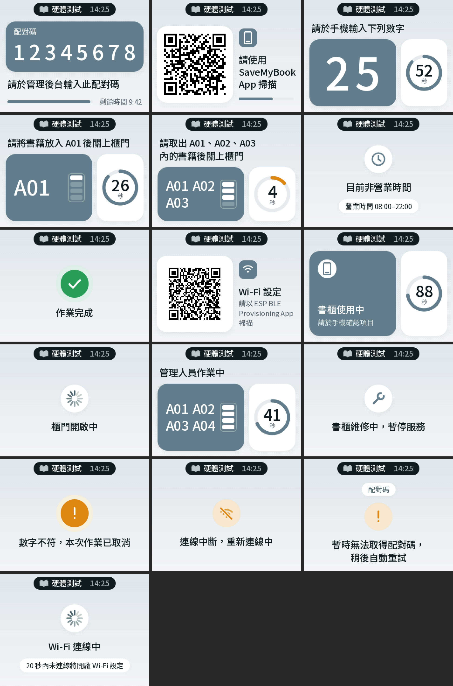

# 智慧書櫃韌體（ESP32-S3）

ESP32-S3 控制四扇櫃門的電磁鎖、門磁與 2.8 吋橫向螢幕，透過 HTTPS 與後端同步。通訊協定見 [`savemybook_api/docs/device.yaml`](../savemybook_api/docs/device.yaml)。

裝置邏輯移植自模擬書櫃 [`savemybook_api/views/kiosk/device-core.js`](../savemybook_api/views/kiosk/device-core.js)，兩邊行為一致；沒有硬體時可用模擬書櫃 `/kiosk` 測試同一套協定。



- [硬體](#硬體)
- [接線](#接線)
- [開發環境](#開發環境)
- [第一次上機](#第一次上機)
- [程式結構](#程式結構)
- [畫面繪製](#畫面繪製)
- [在電腦上檢查](#在電腦上檢查)
- [尚未啟用](#尚未啟用)

## 硬體

### 書櫃

櫃體寬 31 × 深 31 × 高 38 公分，主體為 9 mm 合板，正面面板與四扇櫃門為 5 mm 壓克力雷射切割。櫃門由上而下為 A01–A04，每格平放一本書；鉸鏈在右側，電磁鎖裝在門的左側，螢幕橫放在右上角。3D 建模檔見 [`hardware_design`](../hardware_design)。

### 主控板 Rev A

自製「DoorLock ESP32-S3 主控板」，以 KiCad 10 設計（2026-10-06）。開發板以排母插在主控板上，繼電器、電磁鎖端子、螢幕與門磁接頭都在板上，取代早期以杜邦線連接市售模組的接法（舊版接線圖見 [`Diagrams/Circuit diagram/v4`](../Diagrams/Circuit%20diagram/v4)）。

| 檔案 | 內容 |
|---|---|
| [`pcb/DoorLock_ESP32S3.pdf`](pcb/DoorLock_ESP32S3.pdf) | 原理圖 |
| [`pcb/DoorLock_ESP32S3.csv`](pcb/DoorLock_ESP32S3.csv) | BOM |
| [`pcb/gerber.zip`](pcb/gerber.zip) | 打樣用 Gerber 與鑽孔檔 |
| [`pcb/corner_mount`](pcb/corner_mount) | 3D 列印四角固定座（STL、3MF 與產生器 `gen_corners.js`） |

板子 133.05 × 81 × 1.6 mm，沒有固定孔，以四角固定座的溝槽夾住，固定座以雙面膠或熱熔膠黏在櫃內。

| 編號 | 元件 | 數量 | 說明 |
|---|---|---|---|
| U1 | ESP32-S3-DevKitC-1 相容開發板（N16R8） | 1 | 16 MB Flash、8 MB 八線 PSRAM；插在 2 排 1×22 排母上（排距 22.86 mm），第 1 腳在天線端。目前使用 GOOUUU ESP32-S3（與 YD-ESP32-S3 同腳位） |
| J5 | DC 插座 5.5×2.1（CUI PJ-063AH） | 1 | 12V 輸入；電源建議 12V 5A，輸入端串接 4A 慢熔保險絲 |
| U4 | L7805（TO-220） | 1 | 12V 降 5V，供開發板、繼電器線圈與螢幕；須加散熱片 |
| C1／C2 | 電解電容 1000µF 25V／470µF 10V | 各 1 | 12V 端／5V 端 |
| C3／C4 | 陶瓷電容 0.33µF／0.1µF | 各 1 | L7805 輸入端／輸出端，貼近腳位 |
| U5–U8 | PC815 光耦合器 | 4 | 繼電器驅動（腳位同 PC817） |
| Q1–Q4 | S8050 電晶體（SOT-23） | 4 | 驅動繼電器線圈 |
| R1–R8 | 1kΩ | 8 | 光耦合器 LED 與電晶體基極限流 |
| K1–K4 | JQC3F-05VDC-C 繼電器 | 4 | 5V 線圈，使用 NO 接點 |
| D1–D8 | 1N4007（M7） | 8 | D1–D4 為電磁鎖續流、D5–D8 為繼電器線圈續流 |
| D9–D12 | LED | 4 | 繼電器通電指示 |
| JP1 | JD-VCC 跳帽 | 1 | **須短接**：繼電器線圈由 5V 供電 |
| J1–J4 | 5.08 mm 端子台 | 4 | 電磁鎖 A01–A04 |
| J6 | 1×8 排針 | 1 | 螢幕 |
| J7–J10 | 1×3 排針 | 4 | 門磁 A01–A04 |

### 外接元件

| 元件 | 規格 | 數量 |
|---|---|---|
| 電磁鎖 | 12V 0.6A，通電開鎖、斷電上鎖 | 4 |
| 門磁 | MATRIX 微動開關 V3（MS-004V3，JST，GND／VCC／OUT／反相 OUT），門關上時壓下 | 4 |
| 螢幕 | 2.8 吋 SPI TFT 240×320，ST7789（排線印 TPM408-2.8，TN 面板），以橫向 320×240 使用；模組須有背光電晶體（板上標 Q1）；觸控與 SD 卡不接 | 1 |
| 電源供應器 | 12V 5A，5.5×2.1 插頭 | 1 |

## 接線

### 腳位

| 功能 | GPIO | 說明 |
|---|---|---|
| 繼電器 A01–A04 | 4、5、6、7 | 低電位觸發 |
| 螢幕 RST／DC／CS | 8、9、10 | |
| 螢幕 MOSI／SCK | 11、12 | SPI2 的 IO MUX 腳位，可跑 80 MHz |
| 螢幕背光 | 13 | LEDC PWM 5 kHz、10 位元，亮度由管理後台設定 |
| 門磁 A01–A04 | 39、40、41、42 | 內部上拉 |
| BOOT 鍵 | 0 | 按住 5 秒清除 Wi-Fi 設定 |

避開的腳位：GPIO0、3、45、46（開機設定）、19、20（USB）、26–37（Flash 與 PSRAM）、43、44（序列埠）、38、48（部分開發板接了 RGB 燈）。

### 接頭

| 接頭 | 腳位 | 接到 |
|---|---|---|
| J1–J4（電磁鎖） | 1／2 | 電磁鎖正極／負極。1 腳經繼電器 NO 接點接 12V |
| J6（螢幕） | 1–8 | 5V、GND、CS、RESET、DC、SDI（MOSI）、SCK、LED，與螢幕模組前 8 腳順序相同；SDO、觸控 T_*、SD 卡不接 |
| J7–J10（門磁） | 1／2／3 | 3V3／GND／OUT。**VCC 只能接 3V3，不可接 5V**；反相 OUT 不接 |
| JP1 | — | 以跳帽短接 |
| J5 | — | 12V 電源 |

- 螢幕模組以 5V 供電，模組上有 3.3V 穩壓；訊號為 3.3V。
- 開發板的 5V 腳預設只能輸入，不要短接開發板上的 IN-OUT 焊點，否則 L7805 的 5V 會倒灌進電腦的 USB。同時接上 12V 與電腦 USB 燒錄是安全的。
- L7805 是線性穩壓，多出的電壓都變成熱：散熱片不可碰到其他線路，櫃體內要留通風。

### 電路行為

- **繼電器驅動**：GPIO 拉低時，5V 經 1kΩ、PC815 的 LED 與指示燈流入 GPIO，光耦合器導通，再經 1kΩ 驅動 S8050，使繼電器吸合；GPIO 為高電位（3.3V）時壓差不足以點亮 LED，繼電器不動作。行為與市售低電位觸發的四路繼電器模組相同，地線共用，沒有完全隔離。
- **一次只讓一顆鎖通電**：韌體逐扇開鎖，前一扇斷電 300 ms 後才對下一扇通電，12V 只需承受一顆鎖的 0.6A。
- **NO 接點**：停電或繼電器故障時，門維持上鎖。
- **開機不誤開**：GPIO4–7 在重開機期間為高阻抗，繼電器不會吸合；韌體開機第一件事是先把腳位寫成斷電，再切成輸出，看門狗重置時也一樣。
- **通電時間**：每次開鎖通電 3 秒（以 `unlock_pulse_ms` 回報後端），讓使用者有時間拉開沒有彈簧的櫃門；韌體將通電限制在 100–3000 ms，至少通電 200 ms 後門磁顯示門已拉開就提早斷電，避免線圈過熱。
- **續流二極體與電容**：吸收電磁鎖與繼電器線圈斷電時的反向電壓；鎖通電的瞬間也不會讓開發板掉電重開。電磁鎖通斷的突波若讓螢幕變白，韌體會在鎖動作後與每 10 秒重送螢幕設定並整面重畫。

## 開發環境

使用 PlatformIO 加 ESP-IDF 6.1（`espressif32 @ 7.1.3`），不使用 Arduino：協定要求的內建憑證套件、Flash 加密與 NVS 加密，Arduino 的預編譯函式庫無法完整開啟。

- 可以安裝 VS Code 的 PlatformIO 擴充套件，或使用命令列 `pio`。
- 第一次編譯會自動下載 ESP-IDF 與編譯器（約 6.6 GB，放在 `~/.platformio`）。
- 燒錄與看紀錄可用開發板的 COM 孔（CH343 序列埠）或 USB 孔（USB Serial/JTAG），紀錄兩邊都會輸出。以 USB 孔開啟序列埠時，開發板會重新開機。

| 指令 | 用途 |
|---|---|
| `pio run -e esp32s3` | 編譯正式版 |
| `pio run -e esp32s3 -t upload` | 燒錄正式版 |
| `pio run -e hwtest -t upload` | 燒錄硬體測試版（見[第一次上機](#第一次上機)） |
| `pio device monitor` | 看序列埠紀錄（115200） |
| `pio run -e esp32s3 -t menuconfig` | 修改設定（在「SaveMyBook cabinet」選單） |

### 設定選項

`src/Kconfig.projbuild`：

| 選項 | 預設 | 說明 |
|---|---|---|
| Device API base URL | `https://api.savemybook.today/api/device/v1` | 後端位址 |
| Firmware version reported to the server | `esp-1.0.0` | 回報給後端的韌體版本 |
| Relay module is low-level triggered | 開 | 主控板 Rev A 為低電位觸發 |
| Screen rotation | 1 | 橫向為 1 或 3，依螢幕排針朝哪一側裝設；畫面上下顛倒時改另一個 |
| Panel controller is ILI9341 | 關 | 目前的螢幕是 ST7789；換成 ILI9341 的螢幕時開啟。晶片設錯時畫面不會轉成橫向，下方四分之一是雜訊 |
| Invert panel colors | 關 | 顏色反相時切換；IPS 面板通常要開 |
| Mirror the screen horizontally | 開 | 字左右相反時切換 |
| Door switches installed | 開 | 沒有裝門磁時關閉，否則空腳位會被當成門開著 |
| Door switch output level when the door is closed | 0 | 門關上時 OUT 的電位；門磁測試版顯示相反時改成 1 |
| Screen SPI clock (MHz) | 80 | 螢幕接在主控板 J6 時用 80；以杜邦線連接時 40 MHz 以上會整面亂碼，改回 10 |

### 系統設定

`sdkconfig.*` 不納入版本控制，專案設定以 [`sdkconfig.defaults`](sdkconfig.defaults) 為準（第一次編譯時產生）。

| 項目 | 設定 | 原因 |
|---|---|---|
| 效能 | `-O2`、CPU 240 MHz、FreeRTOS 1 kHz | 書櫃為市電供電，不需省電；1 ms 刻度讓動畫穩定排在 60 fps |
| PSRAM | 八線 80 MHz，找不到時照常開機 | 放畫面快取；沒有 PSRAM 時改為每段整個重畫 |
| 螢幕 | SPI 80 MHz | 整張畫面傳輸約 15 ms |
| 藍牙 | NimBLE | Wi-Fi 設定（ESP BLE Provisioning） |
| 看門狗 | 工作看門狗 30 秒，逾時重開 | |
| 紀錄 | 開機階段只印警告，`app_main` 一開始調回 Info | 開機時少等序列埠輸出 |
| 網路 | DHCP 沿用上次的 IP，略過取得 IP 後的 ARP 衝突檢查 | 連線時間由約 1 秒降為約 70 ms |
| mbedTLS | 橢圓曲線固定點查表 | 伺服器憑證為 ECDSA，HTTPS 握手與 WPA3 運算快 3–4 倍（韌體多約 29 KB） |
| 憑證 | ESP-IDF 完整憑證套件 | 驗證伺服器 |

修改 `sdkconfig.defaults` 後，要刪除 `sdkconfig.esp32s3`（或 `sdkconfig.hwtest`）讓它重新產生，並刪除 `.pio/build/<環境>/bootloader`：PlatformIO 不會自動重新設定 bootloader。

### 分割表

`partitions.csv`（Flash 以 4 MB 設定）：

| 分區 | 位址 | 大小 | 用途 |
|---|---|---|---|
| nvs | 0x9000 | 24 KB | Wi-Fi 設定、裝置憑證、裝置編號、螢幕亮度 |
| phy_init | 0xF000 | 4 KB | 射頻校正資料 |
| factory | 0x10000 | 3 MB | 韌體（沒有 OTA 分區） |
| evq | 0x310000 | 256 KB | 事件佇列、事件序號、開門中紀錄（寫入頻繁，獨立分區分散磨耗） |
| nvs_keys | 0x350000 | 4 KB | NVS 加密金鑰（尚未啟用） |

## 第一次上機

1. **整板測試**（不連網路，先不接電磁鎖）：
   ```bash
   PLATFORMIO_BUILD_FLAGS="-DSMB_HW_TEST_BOARD=1" pio run -e hwtest -t upload
   ```
   - 開機後 3 秒內繼電器都不能吸合。
   - 螢幕上方是色條，由左到右應為紅、綠、藍、白、黑、灰；下方四格是 A01–A04 的門磁，壓下（門關）為「關」，放開為「開」，並顯示原始電位。
   - 繼電器 A01 到 A04 輪流通電 1 秒，通電那格加框，板上 D9–D12 同時亮。按開發板的 BOOT 鍵可暫停或恢復輪流。
   - 開發板的 USB 孔可下指令，每行一個：`1`–`4` 通電 1 秒、`h1`–`h4` 通電 3 秒、`all` 四顆依序、`s` 停止輪流、`a` 恢復輪流、`b50` 背光 50%、`d` 印出狀態。紀錄每 5 秒印一次狀態。
   - 繼電器指示燈亮但沒有聲音：確認 JP1 已短接。
2. **接上電磁鎖再測一次**：量 12V 在通電時的壓降，確認開發板不會重開。建議先只接一顆。

   | 測試版 | 用途 |
   |---|---|
   | `pio run -e hwtest -t upload` | 開機 5 秒後繼電器逐顆通電 0.8 秒，再輪播所有畫面與背光亮度 |
   | `PLATFORMIO_BUILD_FLAGS="-DSMB_HW_TEST_DOOR=1" pio run -e hwtest -t upload` | 只重複測試指定的櫃門（1–4），約每 7 秒開鎖一次 |
   | `PLATFORMIO_BUILD_FLAGS="-DSMB_HW_TEST_RELAY_ONLY=1" pio run -e hwtest -t upload` | 四扇輪流開鎖、不輪播畫面（約 12 秒一輪） |
   | `PLATFORMIO_BUILD_FLAGS="-DSMB_HW_TEST_DOORS=1" pio run -e hwtest -t upload` | 只顯示門磁狀態與原始電位，不開鎖 |
3. **燒錄正式版並設定 Wi-Fi**：
   - 螢幕顯示 Wi-Fi 設定用的 QR Code，以手機上 Espressif 官方的「ESP BLE Provisioning」App 掃描，選擇網路並輸入密碼。
   - 設定密碼每次開機隨機產生，只出現在螢幕上，必須在書櫃前才能設定（Security 2）。
   - 已設定的網路連不上超過 20 秒，螢幕會自動顯示 Wi-Fi 設定的 QR Code（櫃體封起來後不必按按鈕），同時每 15 秒再試一次原本的網路，連回去就自動結束設定。
   - 也可以按住開發板的 BOOT 鍵 5 秒，清除 Wi-Fi 設定並重新開機；裝置憑證保留。
4. **配對**：
   - 連上網路後，螢幕顯示 8 位數配對碼。
   - 管理員在後台「書櫃裝置」輸入配對碼即可，書櫃上不需操作。
   - 配對成功後，螢幕改顯示書櫃 QR Code。

## 程式結構

### 工作

| 工作 | 核心 | 優先權 | 內容 |
|---|---|---|---|
| `locks` | 不固定 | 6 | 依序開鎖，任何時刻只有一顆電磁鎖通電 |
| `net` | 0 | 5 | 輪詢與事件上傳；HTTPS 金鑰運算量大，固定在核心 0，避免擠掉畫面 |
| `door` | 不固定 | 5 | 門磁每 20 ms 取樣，連續 5 次相同才視為改變 |
| `wifistart` | 0 | 5 | 開機時啟動 Wi-Fi，與螢幕初始化同時進行 |
| `ui` | 1 | 4 | 畫面繪製：有動畫時約 60 fps，靜態畫面每 250 ms 檢查一次，狀態改變時立即重畫 |
| `key` | 不固定 | 2 | BOOT 鍵 |

開鎖與網路分在不同工作：開鎖不會被 HTTPS 請求卡住。

### 檔案

| 檔案 | 內容 |
|---|---|
| `src/main.cpp` | 開機順序、畫面工作、BOOT 鍵、硬體測試 |
| `src/device.cpp` | 裝置協定：配對、開機代碼、輪詢、事件佇列、開鎖、倒數與結束作業；連續 3 次網路失敗顯示離線，退避 2／4／8／15 秒；往返超過 3 秒的回應不開鎖 |
| `src/http.cpp` | HTTPS 長連線，以內建憑證套件驗證伺服器；關閉 Nagle 延遲；Wi-Fi 斷線後改開新連線 |
| `src/wifi.cpp` | Wi-Fi 與藍牙設定（Security 2）；平常關閉省電模式（開啟藍牙設定時切回）；記住上次的頻道，開機直接從該頻道連線 |
| `src/store.cpp` | NVS：裝置憑證放 `nvs` 分區，事件佇列放 `evq` 分區 |
| `src/relay.cpp` | 繼電器；門磁顯示門已拉開時提早斷電 |
| `src/door.cpp` | 門磁去彈跳 |
| `src/clock.cpp` | 以後端回應的 `Date` 標頭校時，標題列顯示臺灣時間 |
| `src/display.cpp` | 螢幕驅動：分段傳輸、內容比對、連續段落串流 |
| `src/canvas.cpp` | 抗鋸齒繪圖：文字、圓角矩形、陰影、弧線、漸層、混色 |
| `src/ui.cpp` | 各畫面版面、畫面快取與轉場 |
| `src/boardtest.cpp` | 主控板 Rev A 整板測試 |
| `src/demo.cpp` | 示範畫面資料，供硬體測試輪播與電腦預覽 |
| `src/pins.h` | 腳位與 Kconfig 選項 |
| `src/messages.h` | 螢幕字串表（與模擬書櫃相同） |
| `src/fonts.c`、`src/logo.c` | 由 `tools/` 產生的點陣字型與標誌，請勿手動修改 |

## 畫面繪製

畫面為亮色系，配色比照 App（主色霧藍 #627D8D）；頂部膠囊顯示專題名稱、時間與離線狀態。螢幕沒有完整的畫面緩衝，繪製流程如下：

1. **畫面快取**：每個畫面不變的部分（背景、卡片、陰影、文字）先畫進 PSRAM 的整張快取。快取在內部記憶體以 24 列為一批畫好再寫入 PSRAM，每張畫面最多花 5 ms 建立，畫好前沿用舊快取，換畫面或時鐘跳分時動畫不會中斷。
2. **動態元件**：每張畫面複製快取後，只繪製會動的部分（轉圈、倒數圓環與秒數、進度條、結果圖示）。程式中每個元件以 `staticPass()`／`dynamicPass()` 標明屬於哪一層，畫進快取的內容必須涵蓋在 `keyOf()` 的畫面識別中。
3. **只送有變的部分**：畫面分成 10 段（每段 24 列），內容未變的段落不重送；畫面靜止時只重畫上一張動態元件所在的段落。兩個 DMA 緩衝輪流使用，連續變動的段落設定一次寫入範圍後串流送出，傳送與繪製同時進行。
4. **轉場**：舊畫面淡出 130 ms，新畫面淡入並上滑 280 ms；混色由兩顆核心各算一半。
5. **QR Code**：網路工作收到新內容時先在核心 0 產生，畫面工作直接取用。

沒有 PSRAM 時改為每段整個重畫，功能相同、動畫較不順。

## 在電腦上檢查

以下工具直接使用 `src/` 的程式碼，需先執行過一次 `pio run`，讓 `managed_components` 下載 cJSON 與 qrcode 元件。

| 指令 | 內容 |
|---|---|
| `bash tools/devtest/run.sh` | 裝置邏輯測試：`device.cpp` 原封不動，接上依協定寫的模擬伺服器，以真實時間執行 |
| `bash tools/preview/run.sh` | 輸出各畫面的實際像素到 `tools/preview/out/`，並合成 `sheet.png`（需要 Pillow） |
| `python3 tools/make_fonts.py` | 修改 `src/messages.h` 的字串後重新產生 `src/fonts.c`（只收錄用到的字，取自 App 的 Noto Sans TC） |
| `python3 tools/make_logo.py` | 由模擬書櫃的書本圖示產生 `src/logo.c` |

`tools/devtest` 涵蓋的情境：

- 配對與憑證撤銷後重新配對
- 逐扇開鎖與 300 ms 間隔、重複指令不重複執行
- 手機完成或取消、倒數逾時
- 往返超過 3 秒不開鎖
- 開門中斷電重開
- 斷線與恢復、連續失敗顯示離線
- 門磁：斷電後才拉開仍算正常開啟、門開著不結束作業、強制開啟與未關門的故障回報

## 尚未啟用

協定要求的 **Flash 加密** 與 **NVS 加密** 還沒有開啟。啟用後會燒錄 ESP32-S3 的 eFuse，無法復原，也會限制之後重新燒錄的方式；實機測試穩定、準備上線時再啟用。
